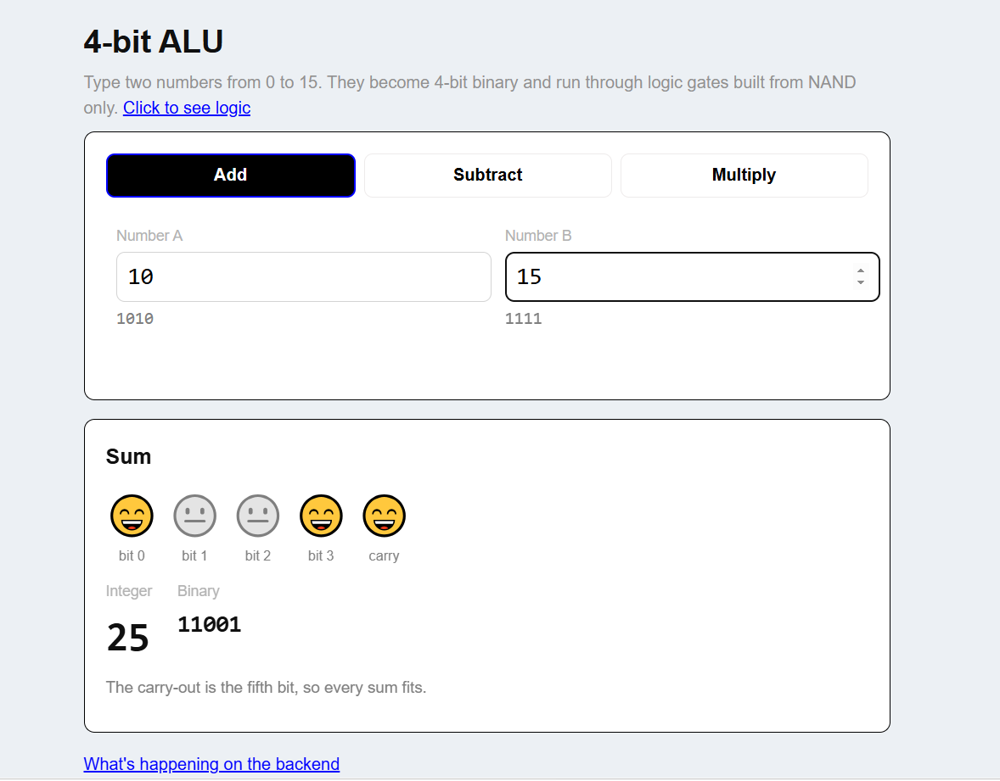
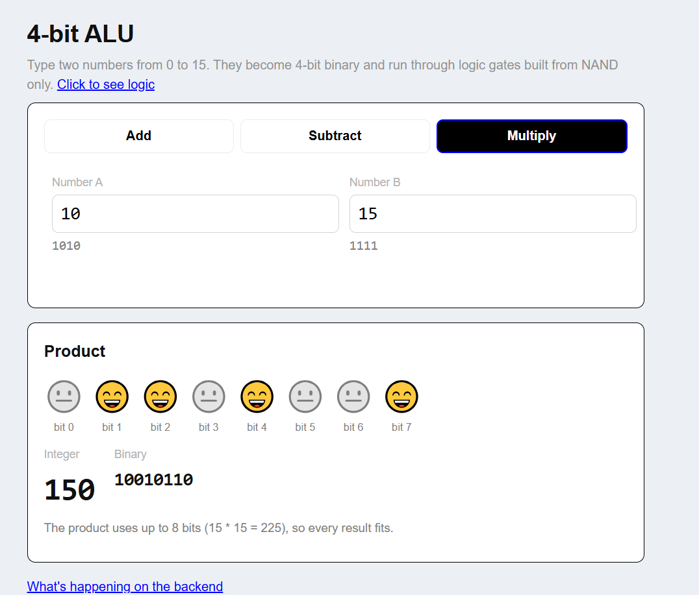
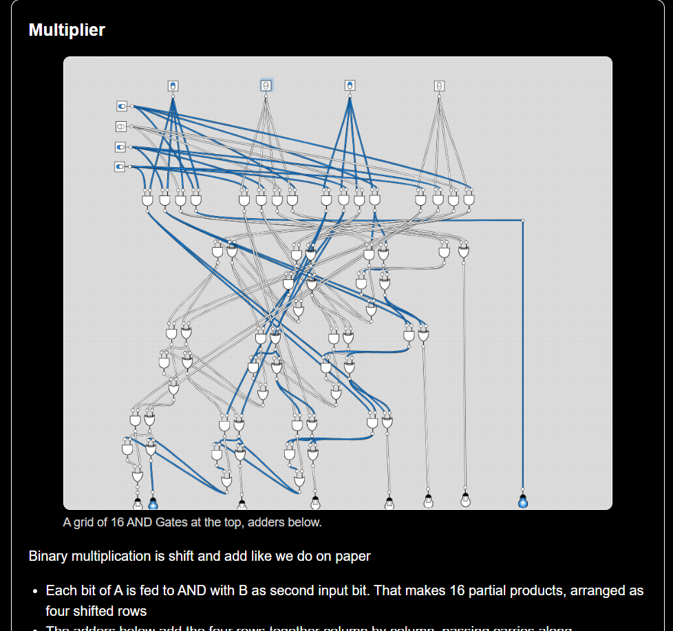

## 4-bit-Alu that built using c++

# DEMO:

## Where to find

Click here to use: https://darshconquerer.github.io/4-bit-Alu/

## How to run locally

Make sure you have git installed
# Open a new vsc (or whatever ide you use) window and paste this in its powershell terminal:
 git clone https://github.com/darshconquerer/4-bit-Alu

 Find the index.html file and run it on live server or by simply opening index.html from locally cloned folder

## Features

1) Built using NAND gates only.
2) AND, OR, XOR, NOT is used to implement half adder, full-adder and those logic gates are built on top of universal NAND.
3) 4-bit adder can contain overflow as it's capable of giving 5 bit output
4) 4-bit multiplier is capable of handling overflow too as it can output 8-bit binary.
5) Real C++ logic in the browser The gate logic is written in C++ (`alu.cpp`) and compiled to WebAssembly with Emscripten. The webpage only handles input and display.

## Deployment: 

Using Github Pages

## Project structure

## What I learned

I learned about how logic gates are used to perform calculations at the basic level, how to turn c++ program into webassembly, emcripten, and about the 4-bit system

## Future goals

1) Adding a 4-bit divider
2) Creating an 8-bit logic unit
3) Simulating pixles using 8-bit alu
4) Creating a basic pixelated game 

## Use of AI

Debugging only, images used were created by me using logic.ly

## What I look forward to build

Build chip-8 emulator just to practice and dive more
I want to emulate the early consoles and a limited version of Nokia 3310
